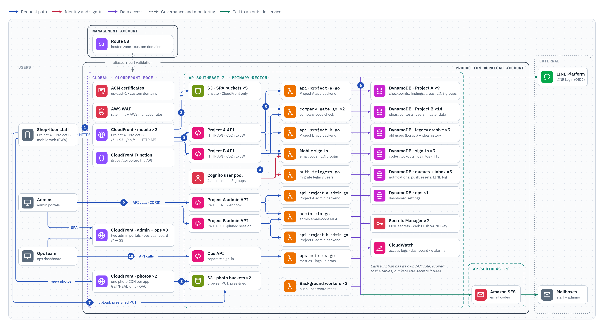
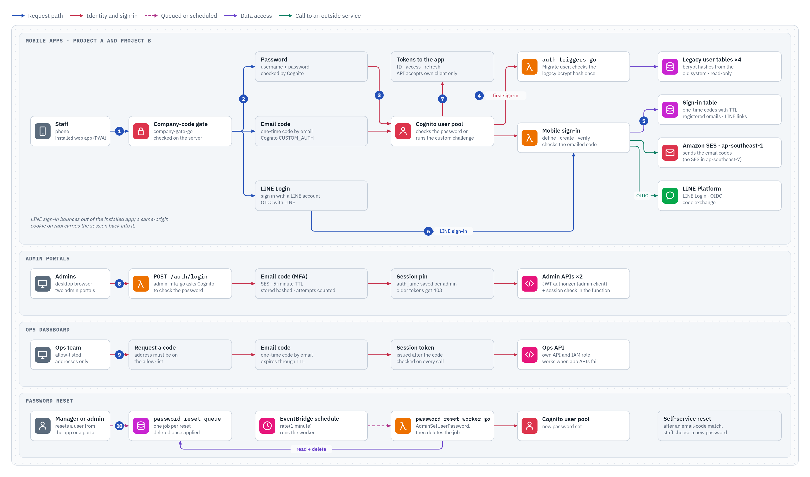
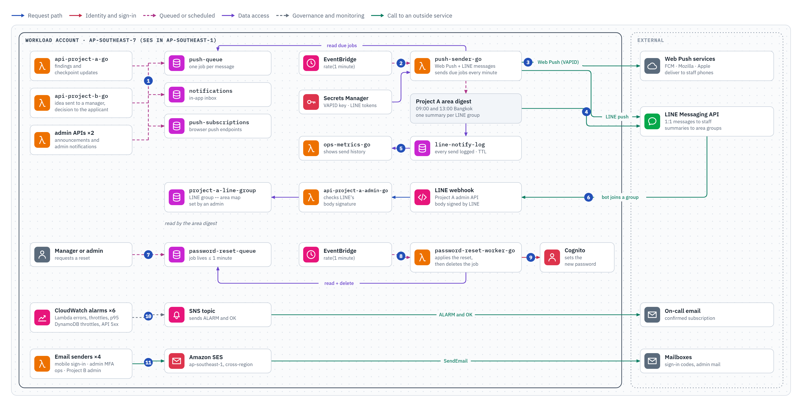
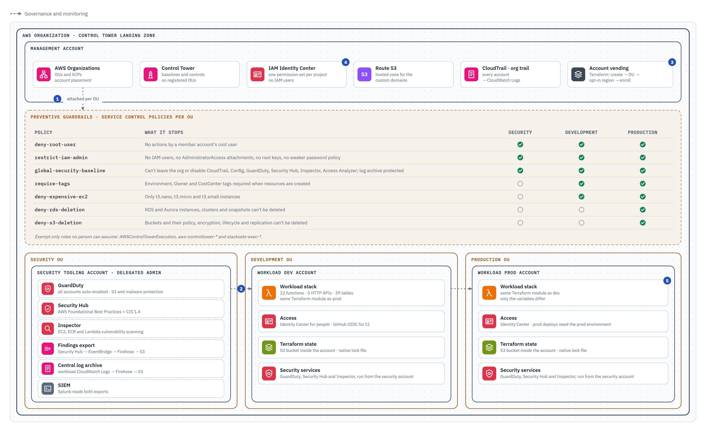
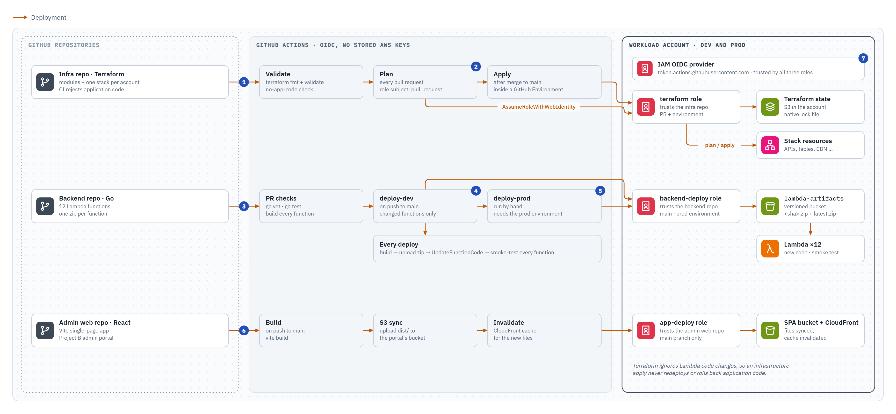

# AWS IaC Portfolio

Terraform for a secure multi-account AWS environment: a Control Tower landing zone with preventive guardrails, organization-wide threat detection and keyless CI/CD. The case study below shows a serverless production workload that runs inside it.

> [!NOTE]
> This repository is a showcase. Account IDs, OU IDs, domains and email addresses in it are placeholders, and nothing here deploys anything: CI only checks formatting, validates the configuration offline and scans for secrets.

**Contents:** [Case study](#case-study-project-a--project-b-on-aws) · [Security controls](#security-controls-in-this-design) · [Repository layout](#repository-layout) · [Keeping this repository safe to publish](#keeping-this-repository-safe-to-publish)

## Case study: Project A & Project B on AWS

A serverless rebuild of a factory's two internal systems: **Project A**, where auditors log shop-floor findings, and **Project B**, where staff submit improvement ideas for approval. Two mobile web apps, two admin portals and an ops dashboard run on one Terraform stack, deployed to a dev and a prod account.

| Go Lambda functions | HTTP APIs | DynamoDB tables | CloudFront distributions | Private S3 buckets | VPCs, NAT gateways, stored AWS keys |
| :-: | :-: | :-: | :-: | :-: | :-: |
| **12** | **5** | **39** | **7** | **8** | **0** |

The application stack lives in a private repository; these diagrams were drawn from its Terraform code. LINE is the messaging platform the apps use for sign-in and notifications. The numbers on each diagram match the steps below it, and you can click a diagram to open it at full size.

### 1. Request flow

How a request travels from a phone or a desktop browser to the data, in the production account.

<a href="docs/architecture/1-request-flow.png">
<picture>
  <source media="(prefers-color-scheme: dark)" srcset="docs/architecture/1-request-flow-dark.png">
  
</picture>
</a>

1. Staff open the app on its custom domain. TLS comes from ACM, and the WAF filters every request first.
2. CloudFront serves the app shell from a private S3 bucket through Origin Access Control.
3. API calls go to `/api/*` on the same origin. A CloudFront Function strips the prefix and forwards the call to the app's HTTP API.
4. API Gateway checks the Cognito JWT before any code runs. Each API only accepts tokens issued to its own app client.
5. Each route invokes its own Go function. Cognito also calls two of them as sign-in triggers.
6. Each function reads and writes DynamoDB, Secrets Manager and SES through its own IAM role, scoped to what it uses.
7. Photos upload straight from the browser to S3 with a presigned URL; no image passes through Lambda.
8. Photos are viewed through a read-only CloudFront distribution.
9. Admins load their portal from CloudFront and call the admin APIs directly, with a JWT plus a session pinned to their last email-code sign-in.
10. The ops dashboard has its own API and sign-in, so it keeps working when an application API fails.

### 2. Sign-in

Three ways in for factory staff, a two-step sign-in for admins, a separate sign-in for the ops team, and a queued password reset.

<a href="docs/architecture/2-sign-in.png">
<picture>
  <source media="(prefers-color-scheme: dark)" srcset="docs/architecture/2-sign-in-dark.png">
  
</picture>
</a>

1. The app asks for the company code first. `company-gate-go` checks it on the server and locks out repeated misses.
2. Staff pick a sign-in method: password, email code or LINE.
3. Cognito checks the password, or runs the custom challenge for an email code.
4. On a first password sign-in, the Migrate User trigger checks the legacy bcrypt hash and creates the Cognito user. Nobody had to reset a password.
5. For an email code, the sign-in function creates a one-time code, sends it through SES, keeps it with a TTL and checks the answer.
6. LINE Login runs through the same function, which exchanges the code with LINE.
7. Cognito returns tokens for that app client only.
8. Admins sign in with a password, then an emailed code. The API rejects any token whose `auth_time` differs from that last code sign-in.
9. Ops sign in with a one-time code sent to an allow-listed address, through an API that is separate from the app APIs.
10. Password resets are queued and applied by a worker within a minute; each job is deleted once applied.

### 3. Notifications & jobs

Everything that happens outside a request: push and LINE messages, LINE group webhooks, password resets, alarms and email. Two EventBridge schedules drive the workers once a minute.

<a href="docs/architecture/3-notifications-and-jobs.png">
<picture>
  <source media="(prefers-color-scheme: dark)" srcset="docs/architecture/3-notifications-and-jobs-dark.png">
  
</picture>
</a>

1. API functions never call a push service directly. They queue a job and write the in-app notification.
2. EventBridge runs `push-sender-go` every minute. Not real-time, by design.
3. Web Push goes out signed with the VAPID key from Secrets Manager.
4. LINE: Project B events go one-to-one to staff; Project A area summaries go to LINE groups at 09:00 and 13:00.
5. Every LINE send is logged with a TTL, and the ops dashboard shows the history.
6. When the Project A bot joins a LINE group, LINE calls the webhook. The function checks LINE's signature and records the group for an admin to map to areas.
7. Password resets are queued from the app or an admin portal.
8. A second one-minute schedule runs the reset worker.
9. The worker sets the password in Cognito and deletes the job.
10. Six alarms email the on-call address through SNS on ALARM, and again on OK.
11. Sign-in codes and admin email go through SES in ap-southeast-1, because SES isn't offered in ap-southeast-7.

### 4. Accounts & guardrails

Where the workload sits in the organization: preventive SCPs per OU, a delegated security account watching every member, and dev and prod as separate accounts built from the same code.

<a href="docs/architecture/4-accounts-and-guardrails.png">
<picture>
  <source media="(prefers-color-scheme: dark)" srcset="docs/architecture/4-accounts-and-guardrails-dark.png">
  
</picture>
</a>

1. SCPs come from one OU-to-policy table in Terraform. The security baseline merges three policies into one to stay under the per-target SCP limit.
2. The security tooling account is the delegated admin for GuardDuty, Security Hub and Inspector, which are auto-enabled in every member account.
3. Workload accounts are created by Terraform and enrolled in Control Tower, so each starts with its OU's baseline.
4. People sign in through IAM Identity Center and CI through GitHub OIDC. No IAM users or long-lived keys exist.
5. Dev and prod run the same stack module; only the variables differ.

In this repository: [`examples/org-guardrails`](examples/org-guardrails) holds the OU-to-SCP table, [`examples/security-tooling`](examples/security-tooling) the delegated security tooling and [`examples/account-vending`](examples/account-vending) the account creation and enrollment.

### 5. CI/CD

Three repositories deploy through GitHub Actions with short-lived OIDC credentials. Infrastructure and application code ship separately, so an infrastructure change can never roll back a function.

<a href="docs/architecture/5-ci-cd.png">
<picture>
  <source media="(prefers-color-scheme: dark)" srcset="docs/architecture/5-ci-cd-dark.png">
  
</picture>
</a>

1. Infrastructure pull requests run `terraform fmt`, `terraform validate` and a check that no application code slipped into the repository.
2. Plan runs on the pull request; apply runs after the merge, inside a GitHub Environment for each account.
3. Backend pull requests run `go vet`, the tests and a build of every function.
4. A merge deploys the changed functions to dev: upload the zip, update the code, smoke-test every function.
5. Prod is a manual run that needs the prod environment.
6. The admin portal builds, syncs to its bucket and invalidates the CloudFront cache.
7. Each role trusts one repository and specific branches or environments, and its credentials last one session.

In this repository: [`security/github-oidc`](security/github-oidc) creates the OIDC provider and the per-repository roles, and [`examples/github-oidc`](examples/github-oidc) shows them wired up.

## Security controls in this design

- AWS WAF on CloudFront: a rate-based rule, the AWS Common Rule Set and Known Bad Inputs
- Private S3 buckets, reachable only through CloudFront Origin Access Control
- One JWT audience per app; admin sessions pinned to the last email-code sign-in
- One IAM role per function, scoped to the tables, buckets and secrets it uses
- LINE secrets and the Web Push key in Secrets Manager, not in environment variables
- Company code, sign-in codes and MFA attempts are rate-limited
- TTL on short-lived data; point-in-time recovery and deletion protection on business tables
- No VPC or NAT to manage, no IAM users and no long-lived AWS keys (CI uses GitHub OIDC)
- Organization-wide SCPs, GuardDuty, Security Hub, Inspector and an organization CloudTrail trail

## Repository layout

| Path | What it holds |
| --- | --- |
| [`organization/`](organization) | OUs, account vending into Control Tower, and service control policies. `global-security-baseline` merges `deny-leaving-org`, `protect-log-archive` and `protect-security-services` into one policy to stay under the per-target SCP limit. |
| [`security/`](security) | GuardDuty, Security Hub, Inspector, a Security Hub findings export through Firehose, cross-account CloudWatch Logs, IAM Identity Center, IAM, KMS, Secrets Manager, WAF, GitHub OIDC roles and a Splunk SIEM pilot. |
| [`governance/`](governance) | AWS Config recorder and rules, CloudTrail with its S3 log archive, AWS Backup with vault lock, and budgets. |
| [`platform/`](platform) | Building blocks for workloads: Lambda, HTTP and REST API Gateway, CloudFront static sites with OAC, VPC networking, EC2 Auto Scaling with IMDSv2, RDS, S3, ECR, SQS and SNS, CloudWatch alarms and dashboards, and a Grafana pilot. |
| [`examples/`](examples) | Four compositions with placeholder IDs that wire the modules together: `org-guardrails`, `security-tooling`, `account-vending` and `github-oidc`. |

## Keeping this repository safe to publish

- **Fresh history.** The repository started from a clean export of the modules, so none of the working repository's commits are included.
- **Placeholders only.** Every account ID, OU ID, domain and email address in the examples is a placeholder.
- **A strict `.gitignore`.** Terraform state, saved plans, `*.tfvars` files (only `*.tfvars.example` is allowed), keys, `.env` files and data exports such as `*.json` and `*.csv` can't be committed.
- **Secret scanning on every push.** [gitleaks](https://github.com/gitleaks/gitleaks) scans every commit in the history on every push and pull request, not just the new ones. The binary is checked against its published SHA-256 before it runs. Findings are printed redacted and never saved as a report, because a report would contain whatever leaked. Reviewed false positives are pinned to the commit they appear in, so they can't hide a new secret on the same line later.
- **A locked-down workflow.** Actions are pinned to full commit SHAs, the workflow token can only read the repository, and checkout doesn't keep credentials.
- **Offline validation.** `terraform fmt -check` and `terraform validate` run on every module and example, with no backend and no AWS credentials.

---

The diagrams reflect the workload's Terraform code as of November 2026. Project A and Project B stand in for the real project names, and account IDs, domains, people and organization names are left out on purpose.
